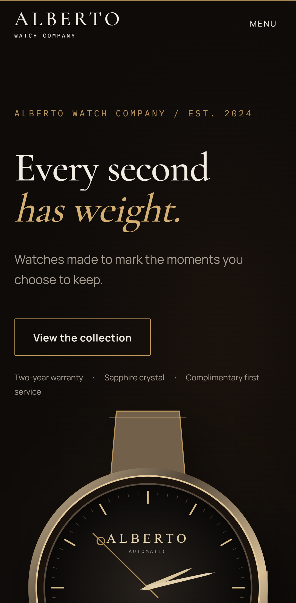
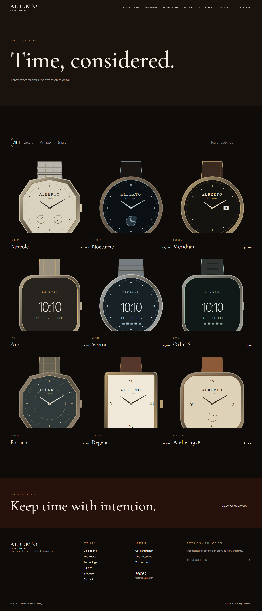

# Alberto Watch Company

Alberto is a React/Vite watch-house site with an Express API, MongoDB Atlas, cookie authentication, an admin desk, and image uploads. The frontend and API deploy together as Vercel Services so browser requests use the same origin.

## Project folders

The React project follows the group assignment layout inside `frontend/`. The repository also includes `backend/` because the catalog, accounts, admin dashboard, and forms use an Express API.

```text
ALBERTO-WATCH/
├── frontend/
│   ├── public/
│   ├── src/
│   │   ├── assets/
│   │   ├── components/   (Navbar, Footer, Sidebar, shared UI)
│   │   ├── pages/        (Home, Login, Register, Dashboard, About, and other pages)
│   │   ├── App.jsx
│   │   ├── main.jsx
│   │   └── index.css
│   └── package.json
├── backend/              (Express API, models, tests)
├── package.json          (runs both projects)
└── README.md
```

Open the repository root in VS Code to work on both the frontend and backend. Run `npm run demo` from this root for a local demonstration.

- Live site: https://alberto-watch-beige.vercel.app
- Source: https://github.com/chikeden/alberto-watch

## Run locally

Install Node.js 20 or newer, then run:

```sh
npm install
npm run demo
```

Open http://localhost:5173/. The terminal prints a temporary demo admin account. The demo uses an in-memory database and local uploads; its data resets when the process stops. Stop both servers with Ctrl+C.

For a persistent local setup, copy `backend/.env.example` to `backend/.env`, set a long `JWT_SECRET` and a MongoDB connection string, then run `npm run seed -w backend` and `npm run dev`. The Vite server proxies `/api` to Express on port 4000. `MONGO_URI` or `MONGODB_URI` is accepted. Set `ADMIN_EMAIL` and `ADMIN_PASSWORD` only when creating or resetting the initial admin account; remove the password from hosted environment variables afterward.

## Hosted setup

The repository root contains `vercel.json`. Its `frontend` service builds the Vite app from `frontend` with `npm run build` and serves `dist`. Its `backend` service runs `backend/server.js`. `/api/*` routes to Express; other paths route to the frontend, including deep links.

Production requires `MONGODB_URI` (or `MONGO_URI`) and `JWT_SECRET`. The current Vercel project connects MongoDB Atlas and a public Vercel Blob store. Admin image uploads use Blob when `BLOB_READ_WRITE_TOKEN` is present. If Cloudinary credentials are configured, Cloudinary takes precedence. Do not commit any credentials or `.env` files.

The hosted API seeds nine watches if the catalog is empty. The production admin email is `onwuad02@gmail.com`; its generated initial password is stored only in the Git-ignored `admin-credentials.local.txt` on the owner's computer. Store it securely and remove that local file when no longer needed.

The nine named watches have individual code-built SVG illustrations with different cases, dials, straps, indices, and complications. Uploaded product photos replace them in the catalog. No third-party product photos are bundled.

The Alberto logo is an original SVG mark used in the navigation, homepage hero, footer, and browser tab. The reusable React version is in `frontend/src/components/Brand.jsx`; the standalone file is `frontend/public/logo.svg`.

## API

| Method | Path | Purpose |
| --- | --- | --- |
| GET | `/api/health` | API and database status |
| POST | `/api/auth/register` | Create customer account |
| POST | `/api/auth/login` | Sign in with an httpOnly cookie |
| POST | `/api/auth/logout` | Clear session |
| GET | `/api/auth/me` | Current user |
| GET | `/api/products?category=&q=&page=` | Filter and search watches |
| GET | `/api/products/:slug` | Watch detail |
| POST | `/api/products` | Admin create, multipart product JSON and up to four images |
| PUT | `/api/products/:id` | Admin edit |
| DELETE | `/api/products/:id` | Admin delete and remove stored images |
| GET, POST | `/api/visitors` | Read or count a visit |
| POST | `/api/contact` | Save an atelier message |
| POST | `/api/newsletter` | Save a subscriber email |
| GET | `/api/admin/stats` | Admin counts |
| GET | `/api/admin/messages` | Recent contact messages |

Errors use `{ "error": { "code": "...", "message": "..." } }`. The API collection is in `docs/Alberto.postman_collection.json`.

## Verify

Run `npm test` for API integration tests and `npm run build` for the frontend. GitHub Actions runs both on pushes and pull requests. The tests cover authentication, admin permissions, catalog filters, visitors, forms, CRUD, and local image uploads. Hosted Blob upload and deletion have also been verified. Contact messages and newsletter addresses are stored in MongoDB; email delivery and mailing campaigns are not configured.

## Screenshot





The [deployment QA notes](docs/qa.md) include live checks, Lighthouse results, and known launch limits.
